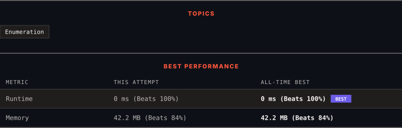

<div align="center">

# 1291. Sequential Digits

      

[](https://leetcode.com/problems/sequential-digits/)

</div>

---

<div align="center">

<picture>
  <source media="(prefers-color-scheme: dark)" srcset="panel-dark.svg">
  <source media="(prefers-color-scheme: light)" srcset="panel-light.svg">
  
</picture>

</div>

### HOW IT WENT

| | |
|:--|:--|
| **Attempts** | 2 before accepted |
| **Time to solve** | 9 min |
| **Verdicts** | ✅ Accepted → ✅ Accepted |

---

### NOTES

_No notes yet._

---

### SOLUTIONS (2)

| # | File | Language | Date |
|:-:|------|:--------:|:----:|
| 1 | [sol1.java](./sol1.java) | `Java` | 2026-10-13 |
| 2 | [sol2.java](./sol2.java) | `Java` | 2026-10-13 ← **latest** |

---

### PROBLEM DESCRIPTION

An integer has *sequential digits* if and only if each digit in the number is one more than the previous digit.

Return a **sorted** list of all the integers in the range `[low, high]` inclusive that have sequential digits.

 

**Example 1:**

```
**Input:** low = 100, high = 300
**Output:** [123,234]

```

**Example 2:**

```
**Input:** low = 1000, high = 13000
**Output:** [1234,2345,3456,4567,5678,6789,12345]

```

 

**Constraints:**

	- `10 <= low <= high <= 10^9`

---

<div align="center">

<sub>Auto-synced by <strong>LeetSync</strong> · Built by <a href="https://deveshsamant.in/">Devesh Samant</a></sub>

</div>
